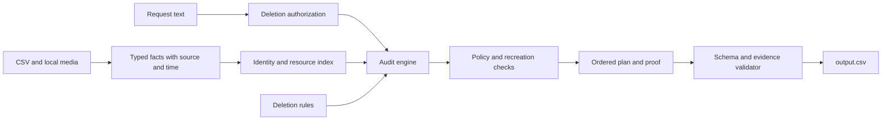

# Challenge review and preferred implementation

Reviewed on 25 October 2026 (Asia/Kolkata), against upstream commit `0eddbbd`.

This document records the initial investigation and build recommendation. The solver and evaluator starter files are empty. No predictions, model evaluation score, or submission have been produced yet.

## Repository and inspection scope

- Fork: https://github.com/NikhilRaikwar/hackerrank-orchestrate-october26
- Upstream: https://github.com/interviewstreet/hackerrank-orchestrate-october26
- Local checkout: `D:\Nikhil Work\Orchestrate\hackerrank-orchestrate-october26`
- Git remotes: `origin` is the personal fork; `upstream` is InterviewStreet.
- Read all 110 original tracked files programmatically, including all CSV rows, JSON records, text and log bytes, and all SQL snapshots. All SQL scripts loaded successfully into isolated in-memory SQLite databases. Extracted all four PDFs and visually inspected all seven pages and all eleven screenshots. Reading and profiling the corpus is not equivalent to having resolved all 518 cases; that requires the solver and evaluation work below.
- See `docs/REPOSITORY_INVENTORY.md` for every original tracked file, byte size, SHA-256, CSV columns and counts, SQL tables and row counts, PDF pages, image sizes, and observed JSON structures.
- `code/main.py` and `code/evaluation/main.py` are both zero-byte placeholders. No baseline implementation or dependency configuration is supplied.

## What must be submitted

Upload at this exact challenge URL:

https://www.hackerrank.com/contests/hackerrank-orchestrate-october26/challenges/ghost-data-still-exists

| Upload | Required content |
| --- | --- |
| `code.zip` | Runnable code, prompts, configuration without credentials, setup/run README, and both evaluation reports |
| `output.csv` | Exactly 518 data rows plus header, one per evaluation request, sorted by `case_id` |
| Chat transcript | The repository-root `log.txt`, following `AGENTS.md` |

The README explicitly requires `code/evaluation/evaluation_report.md` and `code/evaluation/usage_report.md`. Some other passages abbreviate these as `evaluation/...`; using `code/evaluation/` matches the supplied layout and the README's clarification.

The repository also has `agent_trace_instructions.md`, which separately requests an `agent-trace.zip` containing the relevant original agent sessions. This is additional to the three uploads listed in the README and the supplied platform text. Prepare the trace separately and use the upload option exposed by the platform; do not substitute it for `log.txt` or put it inside `code.zip`. The exact fourth upload slot is not established by the supplied platform text.

For this Codex Desktop session, the relevant structured rollout is under `%USERPROFILE%\.codex\sessions\2026\10\25\` and contains this chat's ID `01a16f3c-f4a8-71c0-a2d8-347f59c9318c`. At final submission, finish the sessions before making the final trace copy, include only challenge sessions, and redact credentials/unrelated private content. Never include `auth.json`, `config.toml`, or the full `.codex` directory.

Do not include `dataset/`, the data corpus, virtual environments, `node_modules`, caches, credentials, or nested archives in `code.zip`. Keep prompts and required report details in source or Markdown: the code judge ignores raw `.csv`, `.tsv`, `.json`, `.jsonl`, `.sql`, and `.log` files.

The pasted platform text states a 30-minute AI Judge interview, camera required, available for 12 hours after successful submission. It displays an interview cutoff of 26 October 2026 at 06:00 IST. Its countdown is a snapshot, not a verified absolute submission deadline. The repository explicitly says no October deadline is configured. Re-check the live platform before scheduling submission; do not treat the interview cutoff as the submission deadline.

## Output contract

The root-level file must have exactly this header:

```csv
case_id,deletion_status,steps_json
```

Each `steps_json` value is an ordered JSON array. Each object has exactly these keys:

```json
{
  "step_no": 1,
  "phase": "FINDING",
  "system_id": "<grounded system>",
  "resource_id": "<grounded resource>",
  "operation": "REPORT_REMAINING_RECORD",
  "state": "PRESENT",
  "evidence_id": "<valid file_id, activity_id, or audit_id>"
}
```

| Status | Required output |
| --- | --- |
| `NOT_APPLICABLE` | Request does not authorize deletion; use `[]` and no deletion checks |
| `COMPLETE` | Only verification steps, with evidence proving compliant state at `audit_at` |
| `INCOMPLETE` | Findings with supporting evidence, complete remediation plan, and future verification checks; remediation and future verification use `evidence_id=""` |

Number steps from 1 without gaps. Sort by phase, the operation order below, then ascending `system_id` and `resource_id`. Object key order and JSON whitespace are ignored; array order is scored. Use literal string sorting unless an official update says otherwise; do not invent numeric or natural sorting for IDs.

| Phase | Operation order | Required state |
| --- | --- | --- |
| FINDING | REPORT_REMAINING_RECORD | PRESENT |
| FINDING | REPORT_EXPOSED_PII | PRESENT |
| FINDING | REPORT_ACTIVE_DATA_FLOW | ACTIVE |
| FINDING | REPORT_RESTORE_RISK | ACTIVE |
| REMEDIATION | DISABLE_DATA_FLOW | DISABLED |
| REMEDIATION | BLOCK_RESTORE | BLOCKED |
| REMEDIATION | DELETE_RECORD | ABSENT |
| REMEDIATION | REDACT_RECORD | REDACTED |
| REMEDIATION | ANONYMIZE_RECORD | ANONYMIZED |
| VERIFICATION | VERIFY_RECORD_ABSENT | ABSENT |
| VERIFICATION | VERIFY_RECORD_PRESENT | PRESENT |
| VERIFICATION | VERIFY_RECORD_REDACTED | REDACTED |
| VERIFICATION | VERIFY_RECORD_ANONYMIZED | ANONYMIZED |
| VERIFICATION | VERIFY_DATA_FLOW_DISABLED | DISABLED |
| VERIFICATION | VERIFY_RESTORE_BLOCKED | BLOCKED |

The planning engine should represent dependencies and stop recreation before cleanup. The output serializer must still obey the explicitly scored operation/system/resource ordering; do not reorder the final CSV using an arbitrary graph traversal. Surface any dependency that cannot be reconciled with the required serialization for review.

## Corpus facts

| Input | Count | Purpose |
| --- | --- | --- |
| Evaluation requests | 518 | Only these requests require final predictions |
| Public sample requests and answers | 32 each | Development validation; do not load answers during inference |
| Current identities | 850 | Includes people unrelated to an individual request |
| Historical identity changes | 306 | Recover earlier names, emails, phones, and hashes where present |
| Global activity rows | 4,011 | Claims, resource links, sync/restore history, and operational observations |
| Policy rules | 15 | Required treatment and conditions |
| Evidence manifest entries | 94 | Locate artifacts; not a case membership map |
| SQL snapshots | 24 | Primary, regional, read, reporting, failover, and service inventory tables |
| JSON artifacts | 28 | Nested snapshots, service exports, lookups, configurations, reports |
| Log files | 26 | Multiple formats with trace IDs, retries, readbacks and noise |
| PDF documents | 4 / 7 pages | Business records, support attachments, retention evidence |
| Screenshots | 11 | Product screens with selected records and unrelated rows |
| Other evidence text | 1 | Customer platform handover readbacks |

Evaluation `audit_at` spans 29 January through 1 October 2026. Public samples have 10 COMPLETE and 22 INCOMPLETE labels, with no NOT_APPLICABLE example. Thus a perfect public-sample score would not validate authorization classification. No official scoring weights or guaranteed ranking formula are provided.

## Preferred solution: AI extraction plus a deterministic audit engine

Use Python with typed intermediate records, SQLite indexes, CSV/JSON parsers, a structured log parser, PDF text extraction, and a vision-capable model for screenshots and difficult layouts. Use an LLM for multilingual authorization and ambiguous business semantics. Keep temporal selection, policy application, step construction, validation, and serialization in ordinary code.

Do not send the whole corpus for every request. Extract each artifact once, cache by content hash plus extractor/prompt/model version, index exact identifiers and resource IDs, and retrieve a bounded evidence packet for each request. Keep the original source location with every extracted fact. This architecture is a recommendation based on the corpus, not a measured performance claim.



### 1. Authorize the actual request

Classify access/export, correction, marketing opt-out, account deletion, and deletion confirmation requests semantically, including negation and non-English text. A privacy-related request is not automatically a deletion request. A historical deletion audit may still authorize verification. Use `request_text` as the primary instruction; intake classification events can support investigation but must not override the user's explicit request automatically.

### 2. Resolve identity without merging decoys

Build links from current identity snapshots and historical `old_value`/`new_value` changes to stable user IDs. Normalize email case and surrounding whitespace, Unicode carefully, and phone punctuation for matching while preserving original values. Keep exact hashes and their provenance. Similar names, email prefixes, Gmail-looking aliases, or numeric suffixes do not establish identity.

Resource membership can also come from catalog links, trace-correlated lookups, order/ticket references, selectors and source-resource references. Some facts remain relevant after their PII has been removed, so retain the resource link established by earlier valid evidence. Every edge needs a supporting source and time; resource IDs are opaque and must not encode a guessed case label.

Treat current snapshots carefully when auditing an earlier date: use supplied history to reconstruct what was known then and avoid importing later identifiers as contemporaneous state without support. Do not discard a known historical alias merely because the primary account is now deleted.

### 3. Parse the actual evidence formats

Support the observed JSON shapes: `snapshots[]`, nested `service_exports`, top-level `records`, account lookups with `profile=null`/404, search hit arrays, selectors, retained journals and restore configurations. Preserve null versus empty versus redacted values. Do not assume all artifacts have the same schema.

In SQL, inspect every relevant table, including replicas and embedded `record_json`. Keep topology separate from the logical system/resource key. Absence from a scoped complete table can prove absence only when the matching scope and query coverage justify it; a missing record in a partial export is not deletion proof.

Logs need trace correlation: the start line may contain the identity while the completion line contains the resource and state. Parse both structured and key/value forms. Retry, timeout, cache miss, operation SUCCESS, and readback evidence have different meanings. Read payload fields, not just event names.

PDFs and screenshots are business artifacts rather than deletion verdicts. Extract the selected resource, visible identifiers, ownership/context, dates and retention details. Separate neighboring unrelated rows from the selected subject. Use explicit catalog joins for aliases and artifact-resource mappings; do not hardcode filenames, visible names, or case IDs.

### 4. Reconstruct state at each audit cutoff

Represent facts with logical system, resource, topology, subject links, category, observation time, artifact capture time, asserted fields, state, source ID, and source location. Filter evidence availability and observation time to `audit_at` before making decisions. An old event inside an artifact captured after the cutoff is not automatically admissible.

Sort observations by time, compare scope and specificity, and retain contradictions for targeted review. A recent direct readback usually gives stronger state evidence than an earlier deletion job result, but a rigid latest-row rule cannot erase simultaneous replica drift. A deletion may be followed by sync/import/restore that recreates the record. A disabled connector's old last-delivery status does not make it active, and a historical delivery does not prove it is still disabled.

Choose a citation that directly establishes the selected state and subject. Evidence-ID selection itself is scored, so inspect citation disagreements on public samples even when status and resource set already match. Never select an arbitrary highest-numbered file or use filenames as case-family shortcuts.

### 5. Apply the supplied policy

| Policy category | Treatment |
| --- | --- |
| USER_PROFILE, SECONDARY_IDENTIFIER, SEARCH_INDEX_ENTRY, CACHE_ENTRY, USER_EXPORT, MARKETING_PROFILE | DELETE under their Always rule |
| SUPPORT_ATTACHMENT | DELETE when it belongs only to the deletion subject |
| SUPPORT_MESSAGE | REDACT when shared customer, agent, or order context requires retaining the conversation |
| ANALYTICS_PROFILE, PRODUCT_TELEMETRY | ANONYMIZE if still attributable |
| EMAIL_DELIVERY_LOG | REDACT the user email |
| SECURITY_AUDIT_LOG | RETAIN within the supplied retention period |
| LEGAL_HOLD_RECORD | RETAIN while the supplied legal hold is active |
| BACKUP_ARCHIVE | RETAIN where restore access can be blocked; block unsafe restore paths |
| ACCOUNT_TOMBSTONE | REDACT direct identifiers while preserving the needed stable internal reference |

Load the policy file; do not replace it with assumptions about real privacy law. Evaluate each condition and supplied retention/hold timing. Hashes and stable user links can still make analytics attributable. A tombstone with only a permitted internal reference can be compliant even though an account-related row exists. Preserve required retained records and verify that they remain available.

The allowed remediation enum has no operation to recreate a missing required retained record. If such a case appears, flag it internally and reason from evidence without inventing an unsupported output operation.

### 6. Build and validate the final plan

Find all relevant policy violations and active recreation risks. Disable flows and block restores before record cleanup. For incomplete cases, final verification should cover all required final states, including unaffected records that policy requires retaining, not only items with a remediation action. For complete cases, provide evidence-backed checks for every relevant required state.

Serialize deterministically. Validate allowed phase/operation/state combinations, exact step keys, evidence references and time admissibility, duplicates, sequential numbering, CSV quoting, request coverage, sorting, and status-specific constraints. Do not silently turn extraction failure or missing proof into COMPLETE.

## Evaluation designed for leaderboard improvement

Implement an evaluator independent of prediction code. Run all 32 public requests against their public answers; inference must not read `sample_output.csv`. Compare parsed JSON, not raw CSV text.

Measure status accuracy and confusion matrix; exact whole-case accuracy; step precision/recall/F1 using grounded resource/operation identity; aligned field accuracy including evidence ID; and exact ordered sequence accuracy. Define alignment and denominators in the report. Separate correct steps with wrong citations from wrong policy, missing resources, extra decoys and order errors.

Create at least these additional tests with explicit expected behavior in source/Markdown:

1. An access/export or marketing opt-out request with active personal records: NOT_APPLICABLE and `[]`.
2. Primary deletion succeeds but a replica retains a historical email, and an enabled connector can recreate it: INCOMPLETE with both data and flow treatment.
3. A deleted-account tombstone contains only a permitted user ID and a security record remains within retention: compliant verification without deleting the retained records.
4. The same tombstone retains an email hash: exposed PII, REDACT, then verification.
5. Deletion completes after `audit_at`: the later evidence must not make the earlier audit COMPLETE.
6. A neighboring screenshot/search row has a similar email but no identity link: exclude it.
7. A restore is blocked but its archive must remain: verify both retention and blocked restoration as required.
8. A deletion job claims SUCCESS but a later admissible lookup returns the record: trust the established current state.

Add metamorphic tests: shuffle input rows and file order; consistently rename subjects/resources; add unrelated people; add evidence captured after the cutoff; and remove sample answer access. Predictions should remain equivalent after accounting for intentional renaming.

Review every sample mismatch before a full run. Then run all 518 cases, inspect unresolved conflicts and extraction failures, and validate reproducibility. Optimize time/cost by sharing artifact extraction, not by dropping modalities or assuming labels. A second model pass should target unresolved facts, not rewrite already validated JSON freely.

`evaluation_report.md` must contain actual results, custom tests, failures found, and improvements. `usage_report.md` must contain actual final-run model providers/names, calls, input/output tokens, total/average tokens per request, and estimated total/per-request costs, with per-model and overall totals. Track cached preprocessing attributable to the final run and disclose amortization. Do not invent missing token counts or prices; record provider usage and dated pricing assumptions. Choose the exact provider/model after validating API access and capability; no paid inference has been run in this review.

## Build order and completion gates

1. Add CLI, dependency pinning, typed facts and output validator. Gate: every input is discovered and parsed or explicitly flagged.
2. Build identity index and time-aware resource links. Gate: historical identifiers resolve without decoy merges.
3. Implement structured evidence adapters, then multimodal extraction and source validation. Gate: all 94 artifacts have recorded extraction coverage.
4. Implement state reconstruction, policy engine and deterministic planner. Gate: targeted identity, retention, replica and time tests pass.
5. Implement public-sample evaluator and custom/metamorphic tests. Gate: metrics and mismatch explanations are available; do not claim a rank from them.
6. Add targeted AI adjudication and measure whether it fixes held-out/custom failures. Gate: source-grounded improvements without regressions.
7. Run the final 518 requests and write both reports. Gate: exact schema/coverage, valid evidence, no unresolved silent parser failures, real token/cost accounting.
8. Package and inspect all submissions. Gate: archive contains required code/docs/reports, no dataset/caches/secrets/nested archives; validate `output.csv` and refresh transcript/trace.

Suggested final command interface to implement (these commands do not exist yet):

```text
python code/main.py --dataset dataset --requests dataset/deletion_requests.csv --output output.csv
python code/evaluation/main.py --dataset dataset --requests dataset/sample_deletion_requests.csv --expected dataset/sample_output.csv
```

There is no need for a polished web dashboard to satisfy the published contract. Spend the first implementation effort on exact evidence recovery, time handling, retention and reproducible evaluation. Leaderboard rank is unknown until an actual evaluated submission is made.

## Official references

- README: https://github.com/interviewstreet/hackerrank-orchestrate-october26/blob/main/README.md
- Problem specification: https://github.com/interviewstreet/hackerrank-orchestrate-october26/blob/main/problem_statement.md
- Agent/transcript contract: https://github.com/interviewstreet/hackerrank-orchestrate-october26/blob/main/AGENTS.md
- Additional trace guidance: https://github.com/interviewstreet/hackerrank-orchestrate-october26/blob/main/agent_trace_instructions.md
